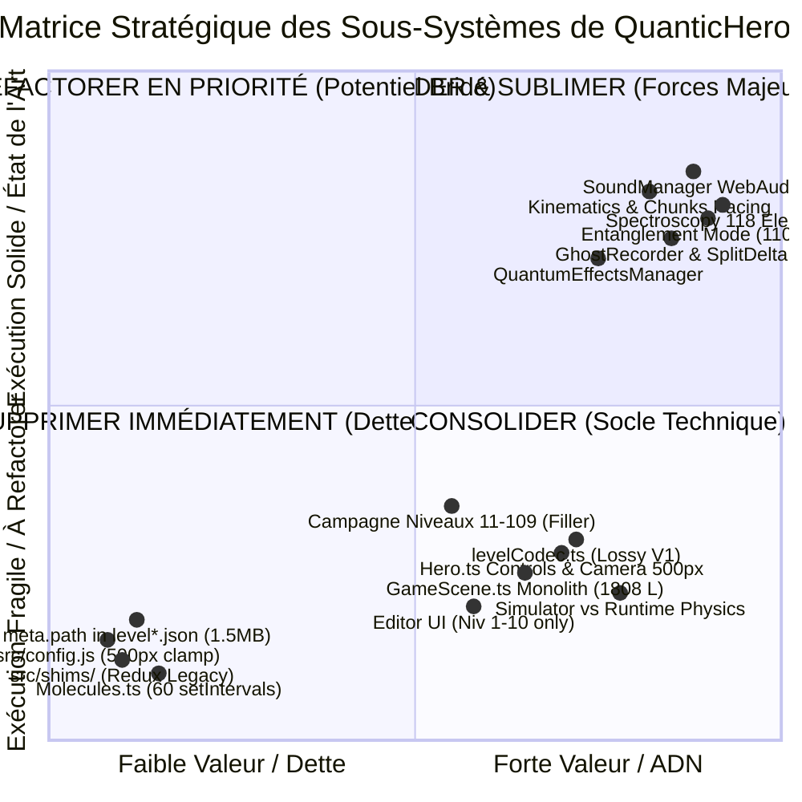
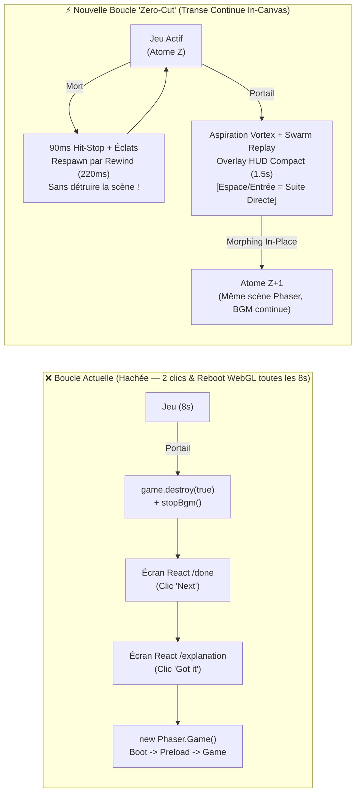
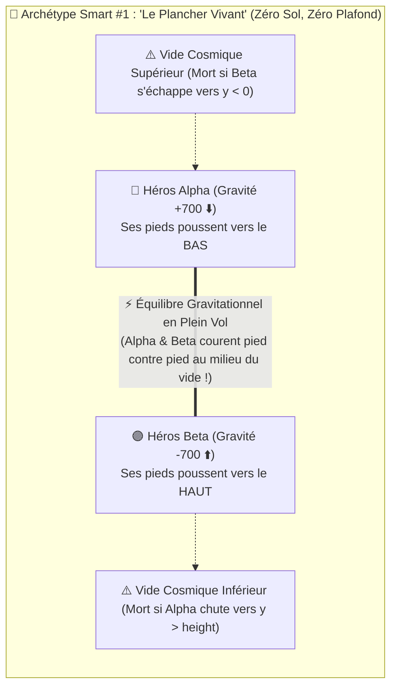
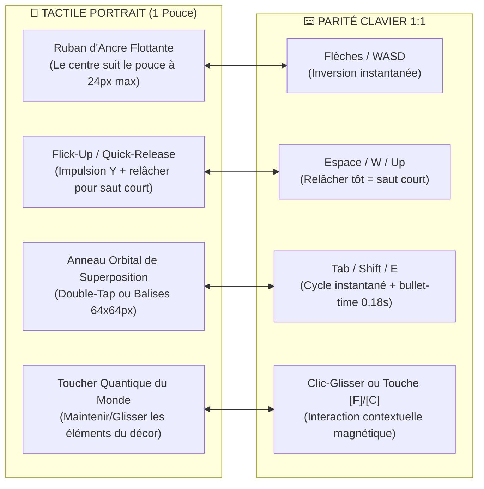
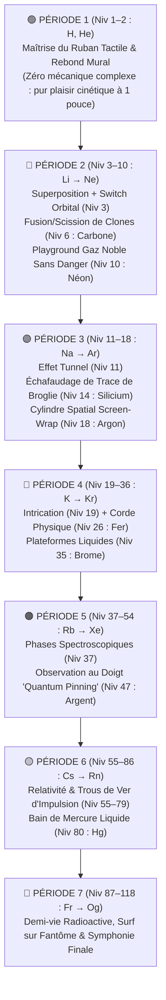
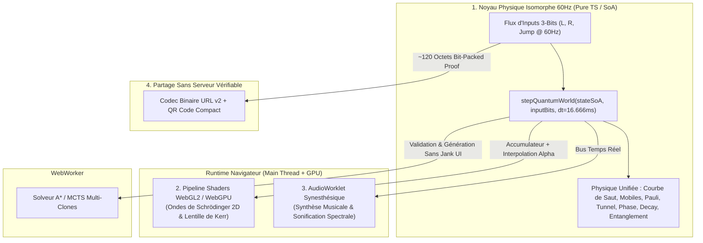

# Audit Complet — QuanticHero (`v2.0.0`)
**Date de l'audit** : 14 novembre 2026  
**Dépôt analysé** : `https://github.com/DavidBonnemaison/QuanticHero`  
**Stack actuelle** : React 19.3.1, Zustand 5.1.0, Phaser 3.88.2 (Arcade Physics), Vite 8.3.8, Vitest 5.1.0, Biome 1.9.4, WebAudio API procédurale, PWA Workbox.

---

## Table des Matières
1. [Synthèse Exécutive : L'ADN réel de QuanticHero](#1-synthèse-exécutive--ladn-réel-de-quantichero)
2. [Matrice Décisionnelle : Garder, Supprimer, Forces & Faiblesses](#2-matrice-décisionnelle--garder-supprimer-forces--faiblesses)
3. [Volet 1 — Audit Fonctionnel & Game Design : État des Lieux](#3-volet-1--audit-fonctionnel--game-design--état-des-lieux)
   - [3.1 Core Loop & Analyse des « 3C » (Character, Controls, Camera)](#31-core-loop--analyse-des--3c--character-controls-camera)
   - [3.2 Juice, Psychoacoustique WebAudio, Haptique & Effets Quantiques](#32-juice-psychoacoustique-webaudio-haptique--effets-quantiques)
   - [3.3 Système de Ghost Speedrun & Paradoxe du Bot Optimal](#33-système-de-ghost-speedrun--paradoxe-du-bot-optimal)
   - [3.4 Analyse Systémique des Mécaniques Quantiques Actuelles](#34-analyse-systémique-des-mécaniques-quantiques-actuelles)
   - [3.5 Architecture de la Campagne (114 niveaux), Génération Procédurale & Éditeur](#35-architecture-de-la-campagne-114-niveaux-génération-procédurale--éditeur)
4. [Volet 2 — Manifeste Game Design : Rendre le Jeu Irrésistible, Immersif, Addictif, « Smart » & « WOW » (Zéro Gimmick Forcé)](#4-volet-2--manifeste-game-design--rendre-le-jeu-irrésistible-immersif-addictif--smart----wow--zéro-gimmick-forcé)
   - [4.1 Rendre le jeu PLUS SYMPA À JOUER (Le « Toy Factor » & le Plaisir Kinésthésique Pur)](#41-rendre-le-jeu-plus-sympa-à-jouer-le--toy-factor---le-plaisir-kinésthésique-pur)
   - [4.2 Rendre le jeu PLUS ADDICTIF (Boucle de Dopamine « Zero-Cut », Swarm Replay & Maîtrise)](#42-rendre-le-jeu-plus-addictif-boucle-de-dopamine--zero-cut--swarm-replay--maîtrise)
   - [4.3 Rendre le jeu PLUS IMMERSIF (Synesthésie Musicale, Cœur Orbital Vivant & Narration Diégétique)](#43-rendre-le-jeu-plus-immersif-synesthésie-musicale-cœur-orbital-vivant--narration-diégétique)
   - [4.4 Rendre le jeu PLUS « SMART » (6 Archétypes d'Épiphanies avec 100 % des Briques Existantes)](#44-rendre-le-jeu-plus--smart--6-archétypes-dépiphanies-avec-100--des-briques-existantes)
   - [4.5 Créer l'Effet « WOW » (4 Mises en Scène Signatures Inoubliables)](#45-créer-leffet--wow--4-mises-en-scène-signatures-inoubliables)
5. [Volet 3 — Audit Technique & Architecture Logicielle (Expertise Principal Software Architect)](#5-volet-3--audit-technique--architecture-logicielle-expertise-principal-software-architect)
   - [5.1 Architecture React 19 + Zustand 5 + Phaser 3 & Dette d'Héritage](#51-architecture-react-19--zustand-5--phaser-3--dette-dhéritage)
   - [5.2 Bugs Critiques Runtime : Double Déclenchement WebAudio & Quota localStorage](#52-bugs-critiques-runtime--double-déclenchement-webaudio--quota-localstorage)
   - [5.3 « Split-Brain Physics » : Dépendance au Framerate & 8 Divergences Runtime vs. Solveur](#53-split-brain-physics--dépendance-au-framerate--8-divergences-runtime-vs-solveur)
   - [5.4 Sérialisation URL (`levelCodec.ts`) & Perte de Données](#54-sérialisation-url-levelcodects--perte-de-données)
   - [5.5 Performances de Rendu, Pression GC, DOM & Bundle](#55-performances-de-rendu-pression-gc-dom--bundle)
6. [Volet 4 — Vision d'Avant-Garde Technique & Scientifique](#6-volet-4--vision-davant-garde-technique--scientifique)
   - [6.1 Innovations Architecturales & Ingénierie d'Avant-Garde](#61-innovations-architecturales--ingénierie-davant-garde)
   - [6.2 Idées Exploratoires de Mécaniques Quantiques Avancées (Optionnelles)](#62-idées-exploratoires-de-mécaniques-quantiques-avancées-optionnelles)
7. [Feuille de Route Priorisée (P0 → P3)](#7-feuille-de-route-priorisée-p0--p3)

---

## 1. Synthèse Exécutive : L'ADN réel de QuanticHero

Alors que son `README.md` historique (6 lignes) le décrivait encore comme un simple prototype *« WIP (30/100) - Built with Phaser CE »*, **QuanticHero (`v2.0.0`)** a silencieusement muté en une œuvre web hybride d'une grande richesse : un **platformer d'arcade et de speedrun néon-cosmique, zero-backend et local-first**, structuré autour des **118 éléments du Tableau Périodique** (`src/data/spectroscopy.ts`) et des lois de la physique quantique et relativiste (`src/mechanics/quantumMechanics.ts`).

### L'identité fondamentale (L'ADN Sacré)
L'ADN de QuanticHero repose sur **cinq piliers** qui le distinguent radicalement de la production indépendante habituelle :
1. **La Table Périodique comme Cosmologie Jouable** : Chaque niveau incarne un atome ($Z = 1$ Hydrogène jusqu'aux éléments superlourds transuraniens), doté de sa véritable palette spectroscopique d'émission optique (`hue`, `antiHue`, `spectralLineNm` dans `src/data/spectroscopy.ts:15-1198`) et d'une narration poétique minimaliste en quatre Actes Cosmiques (`src/data/cosmicNarrative.ts:11-88`).
2. **La Multi-corporéité Quantique (Clonage, Répulsion de Pauli & Intrication $\Psi \otimes \Psi$)** : Le joueur ne contrôle pas seulement un avatar unique, mais une **fonction d'onde multi-corps**. Que ce soit par duplication (`duplicate`), par catapultage mutuel entre fermions identiques (`pauli` dans `src/mechanics/quantumMechanics.ts:99-146`), ou par contrôle simultané de deux jumeaux intriqués Alpha/Beta aux symétries inversées (`entanglement` dans `src/scenes/GameScene.ts:560-614`), le cœur du puzzle-arcade réside dans la **chorégraphie spatiale entre plusieurs instances de soi-même**.
3. **La Course Contre le Fantôme Déterministe (Speedrun Tactile)** : Chaque niveau embarque un `authorGhost` calculé par un solveur physique à 60 Hz (`src/generator/simulator.ts:697-787`) et affiche en temps réel l'écart temporel (`splitDelta` en vert `-0.35s` ou rouge `+0.52s` via `src/tools/GhostRecorder.ts:211-270`).
4. **L'Esthétique 100 % Procédurale « Zéro Asset Lourd »** : Toute l'identité sonore (synthèse FM, battements binauraux stéréo, arpégiateur chiptune réactif au nombre de clones dans `src/audio/SoundManager.ts:1-914`) et lumineuse (ondes de matière de Broglie et lentille gravitationnelle de Kerr dans `src/effects/QuantumEffectsManager.ts:1-267`) est générée mathématiquement au runtime.
5. **Le Partage Viral Sans Serveur (URL / QR Code)** : Toute création ou performance de speedrun est encodée directement dans le hash de l'URL (`#custom=...` via `src/tools/levelCodec.ts`) et partageable par QR Code (`src/components/Editor/ShareModal.tsx`).

---

## 2. Matrice Décisionnelle : Garder, Supprimer, Forces & Faiblesses



### Ce qui fonctionne remarquablement bien (Forces)
- **Synthèse WebAudio procédurale (`src/audio/SoundManager.ts`)** : Zéro fichier audio externe. Utilisation brillante du **battement binaural stéréo** (`220 Hz` gauche vs `226 Hz` droite, `lines 217-257`) lors de la duplication quantique, accords harmoniques distincts par particule (`lines 282-295`), et BGM chiptune dont le tempo (`118 → 126 → 134 BPM`) et le timbre (`sine` $\rightarrow$ `square`) mutent dynamiquement selon le nombre de clones actifs (`lines 800-886`).
- **Mode Intrication Quantique $\Psi \otimes \Psi$ (`src/data/level110.json`–`level114.json`, `src/scenes/GameScene.ts:560-614, 1489-1518`)** : Contrôle simultané de deux héros liés par un faisceau d'onde sinusoïdal à 3 passes (`drawEntanglementBeam`, `lines 1373-1458`), avec cadrage caméra dynamique par centroïde/zoom (`lines 1490-1518`) et arrimage indépendant aux portails (`handleEntangledPortalArrival`, `lines 1145-1181`).
- **Architecture de génération en 4 phases dramatiques (`src/generator/chunkAssembler.ts:95-282`)** : Structure *Éveil (15 %) $\rightarrow$ Accélération (35 %) $\rightarrow$ Climax (35 %) $\rightarrow$ Résolution (15 %)* adossée aux équations analytiques exactes de portée balistique (`src/generator/kinematics.ts:28-81`).
- **Base de données spectroscopique complète (`src/data/spectroscopy.ts:1-1198`)** : Les 118 éléments chimiques documentés avec leurs raies d'émission réelles en nanomètres (`spectralLineNm`) et leurs contrastes chromatiques (`hue`/`antiHue`).
- **Système de Replay & Split Delta (`src/tools/GhostRecorder.ts`)** : Compression delta `v1|` très compacte (`lines 30-71`), interpolation binaire $O(\log N)$ (`sampleTrajectory`, `lines 162-204`) et indicateur d'avance/retard en direct.

### Ce qui fonctionne mal (Faiblesses & Bugs Critiques)
- **Les 2 « Tueurs de Flow » à la mort et à la victoire (`src/scenes/GameScene.ts:757, 1365`)** :
  1. À chaque mort, `this.scene.restart()` relance `showLevelTitle()` (`GameScene.ts:1096-1119`), affichant un titre géant en `48px` en plein milieu de l'écran pendant `2,2 secondes`.
  2. À chaque victoire (toutes les 6 à 10 secondes !), `completeLevel()` détruit tout le moteur Phaser (`this.game.destroy(true)`), coupe la musique (`stopBgm()`), force un passage par `/done` (1 clic souris obligatoire), puis `/explanation` (2ème clic souris obligatoire), avant de réinstancier un `new Phaser.Game()` de zéro !
- **Viewport verrouillé à `500px` de large (`src/config.js:2`) & Absence de Look-Ahead Caméra (`src/scenes/GameScene.ts:616`)** : Sur desktop comme sur mobile, le canevas Phaser est bridé à `500px` de largeur maximale (`width = docElement.clientWidth > 500 ? 500 : docElement.clientWidth`). À `350 px/s` (et `490–620 px/s` sous boost ou Pauli), le joueur centré à `250px` n'a que **0,4 à 0,7 seconde de visibilité frontale**, provoquant des sauts à l'aveugle.
- **Saut rigide, vitesse binaire (`0` ou `350 px/s`) & Absence de *Coyote Time* / *Jump Buffer* (`src/scenes/Hero.ts:192-222`)** : Pas de hauteur de saut modulable (relâcher tôt ne coupe pas l'ascension), gravité de chute identique à la montée (effet flottant), et exigence d'être au sol à la frame près (`jump && touchingGround`) qui punit les sauts en bord de plateforme.
- **Physique Dépendante du Taux de Rafraîchissement (`src/scenes/Hero.ts:170, 214`)** : Le freinage aérien (`velocity.x *= drag`) et l'amortissement du rebond mural (`recoilVx *= 0.94`) sont appliqués *par frame* sans normalisation par `delta`. Sur un écran 120 Hz / 144 Hz, le rebond mural perd plus de **50 % de son impulsion horizontale** en `220ms`, rendant les puits gravitationnels (ex. Niveau 18 Argon) quasi infranchissables.
- **8 Divergences Majeures entre le Solveur (`simulator.ts`) et le Runtime (`GameScene.ts`)** : Les plateformes mobiles (`movesTo`) sont **immobiles dans le solveur**, la dilatation temporelle dure `5000ms` dans le solveur contre `4000ms` en jeu, la géométrie du tunnel et des plaques de pression diffère, et l'impulsion de Pauli est codée en dur (`580, -600` vs `620, -580`).
- **Double Déclenchement Audio sur 7 Événements (`src/scenes/GameScene.ts` + `src/audio/SoundManager.ts`)** : `GameScene` appelle directement `soundManager.play*()` **puis** émet `gameEvents.emit(...)`, que `SoundManager` écoute déjà — doublant les nœuds WebAudio et provoquant un écrêtage de +6 dB (et jouant le son d'activation de dilatation temporelle lors de son expiration à la ligne `1473`).
- **Codec de Partage URL Destructif (`src/tools/levelCodec.ts:68-151`)** : `compressLevel()` omet `kind` (`wall`), `phase`, `decayMs`, `gates`, `pressurePlates`, `collapse` et `entanglement`. Tout lien partagé ou QR code d'un niveau avancé détruit ses mécaniques quantiques.
- **Usage « Clé-Serrure » de certaines mécaniques & Désert des Niveaux 11–109** : Dans `chunkAssembler.ts`, l'effet tunnel (`tunnel`) ou l'inversion de gravité (`antiGravity`) sont posés sur des rails juste devant l'obstacle sans vrai choix ni épiphanie puzzle, et les éléments $Z=115$ (`Mc`) à $Z=118$ (`Og`) n'ont pas leurs fichiers `level115.json`–`level118.json`.

### Ce qu'il faut ABSOLUMENT GARDER (Le Cœur Non-Négociable)
1. **Le socle mathématique et physique pur** : `src/physics/constants.ts`, `src/generator/kinematics.ts` et `src/mechanics/quantumMechanics.ts`.
2. **La base spectroscopique et narrative des 118 éléments** : `src/data/spectroscopy.ts` et `src/data/cosmicNarrative.ts`.
3. **Le moteur de synthèse WebAudio et d'effets lumineux** : `src/audio/SoundManager.ts`, `src/effects/QuantumEffectsManager.ts`, `src/tools/HapticFeedback.ts` et le bus typé `src/tools/gameEvents.ts`.
4. **Les mécaniques de multi-corporéité** : Intrication $\Psi \otimes \Psi$, Répulsion de Pauli, Clonage + Dalles verrouillées (`requireLock`), Superposition de Phase, Effet Tunnel et Demi-vie (`decayMs`).
5. **Le système de Ghost Delta-Encodé (`v1|`) et le Solveur de validation** : `src/tools/GhostRecorder.ts` et l'approche de validation déterministe de `src/generator/simulator.ts`.

### Ce qu'il faut ABSOLUMENT SUPPRIMER ou Remplacer
1. **SUPPRIMER `src/shims/navigation.js` et `src/shims/react-router-redux.js` ainsi que l'alias dans `vite.config.js:92-97`** : Reliques d'une ancienne architecture Redux/React-Router v3.
2. **SUPPRIMER les appels à `this.game.destroy(true)` en fin de niveau (`GameScene.ts:1365`) et l'écran interstitiel bloquant `/explanation` (`src/components/Explanation.tsx`)** : Conserver Phaser en vie d'un atome à l'autre et afficher la poésie de manière diégétique dans le décor du niveau.
3. **SUPPRIMER la bride `width > 500 ? 500` dans `src/config.js:2` et le toast géant de `150px` (`showRetroToast` dans `GameScene.ts:1254`)**.
4. **SUPPRIMER `src/components/Molecules.ts` et la dépendance `randomcolor` (`package.json:25`)** : Ce module crée **60 timers `setInterval`/`setTimeout` concurrents** qui modifient `el.style.left/top` toutes les 30 ms (660 invalidations de layout DOM/seconde).
5. **SUPPRIMER le tableau `meta.path` dans les 114 fichiers `src/data/level*.json` et convertir `src/data/levels.js` (CommonJS) en ESM/TypeScript** : `meta.path` (ex. 511 lignes sur 599 dans `level1.json:85-596`) n'est lu par aucun composant au runtime et représente **~70 % du poids JSON (~1,5 Mo)**.

---

## 3. Volet 1 — Audit Fonctionnel & Game Design : État des Lieux

### 3.1 Core Loop & Analyse des « 3C » (Character, Controls, Camera)

- **Character (`src/physics/constants.ts`, `src/scenes/Hero.ts`)** :
  - Avec $g = 700\text{ px/s}^2$ et $v_0 = -450\text{ px/s}$, le temps d'ascension à l'apogée est $t_{\text{apex}} = \frac{450}{700} \approx 0,643\text{ s}$ pour une hauteur maximale $\Delta y_{\max} = \frac{450^2}{2 \times 700} \approx 144,64\text{ px}$ (`src/generator/kinematics.ts:28-40`).
  - La vitesse au sol est binaire (`0` ou `±350 px/s` en 1 frame dans `Hero.ts:192-211`).
  - Point positif : `isHighSpeed` (`Hero.ts:190-195, 213-214`) préserve intelligemment l'impulsion horizontale au-delà de `350 px/s` lors d'un blast de Pauli.
  - Point négatif : Absence de *Coyote Time*, absence de *Jump Buffering*, et parabole de saut figée (`Hero.ts:218`).
- **Controls (`src/scenes/GameScene.ts:731-741, 821-844`)** :
  - Sur clavier : Pas de support natif `ZQSD` pour les claviers AZERTY, pas de touche `R` pour recommencer rapidement, pas de touche `Tab` pour changer de clone actif, et aucune touche (`Space`/`Enter`) reliée aux boutons des écrans `Explanation.tsx` et `LevelFinished.tsx`.
  - Sur mobile (`setupPointerControls`, `lines 821-844`) : Contrôle par glissement relatif (`deltaX > 20`, `deltaY < -20`) sans retour visuel ni remise à zéro du point neutre lors d'un changement de direction.
- **Camera (`src/config.js:2`, `src/scenes/GameScene.ts:604-617, 1489-1518`)** :
  - Excellente gestion du barycentre et du zoom dynamique (`0.28` à `1.0`) en mode Intrication (`isEntangled = true`, `lines 1490-1517`).
  - En revanche, dans les niveaux 1 à 109, la largeur fixe de `500px` combinée à l'absence de *look-ahead* réduit le temps d'anticipation visuel à moins de `0,5 s` à pleine vitesse.

### 3.2 Juice, Psychoacoustique WebAudio, Haptique & Effets Quantiques
- **Audio (`src/audio/SoundManager.ts`)** : Synthèse procédurale remarquable (battement binaural sur `playDuplicate` aux lignes `206-266`, synthèse FM sur `playTunnelSound` aux lignes `433-475`, arpèges dédiés par particule aux lignes `272-319`). Toutefois, la boucle musicale BGM (`lines 814-843`) joue les 4 mêmes notes de basse (`A1, F1, D2, E2`) sur l'intégralité des 114 niveaux.
- **Haptique (`src/tools/HapticFeedback.ts`)** : Proprement découplé via `gameEvents`, mais il manque les abonnements aux événements V2 (`pauli:blast`, `tunnel:use`, `phase:shift`, `hero:wall_bounce`, `platform:decay`, `plate:trigger`).
- **Effets Visuels (`src/effects/QuantumEffectsManager.ts`)** : Ondes de matière de Broglie et vortex de Kerr très réussis avec auto-throttling sous 50 FPS (`lines 78-93`), mais pollués visuellement par les textes géants `showRetroToast` en `150px` (`GameScene.ts:1254-1272`) et par un fond générique de 25 ronds aléatoires (`createMolecules`, `lines 804-819`).

### 3.3 Système de Ghost Speedrun & Paradoxe du Bot Optimal
1. **Masquage lors du premier run** (`GameScene.ts:713-726`) : Le fantôme est désactivé tant que le joueur n'a pas déjà terminé le niveau une première fois (`isReplay`).
2. **Piétinement du Bot « Optimal »** (`src/generator/simulator.ts:598-606`) : Dans `simulatePlatformTransition()`, dès que le bot atterrit sur une plateforme, il cherche à s'arrêter à `Math.abs(distToCenter) <= 25` avant de sauter vers la plateforme suivante. À cause de sa vitesse, il dépasse le centre et oscille d'avant en arrière sur chaque plateforme (visible dans `src/data/level1.json:145-175`), perdant 3 à 4 secondes par niveau.

### 3.4 Analyse Systémique des Mécaniques Quantiques Actuelles
- **Clonage (`duplicate`) & Dalles (`requireLock`)** : Haut potentiel de puzzle multi-corps, mais les dalles et barrières (`gates`/`pressurePlates`) ne sont utilisées **qu'une seule fois dans toute la campagne** (Niveau 14 Silicium, `chunkAssembler.ts:694-713`).
- **Effet Tunnel (`tunnel`)** : Actuellement cantonné à un rôle de « clé-serrure » linéaire devant un mur de `30px` (Niveaux 29, 46, 84, 88, 100, 109).
- **Répulsion de Pauli (`pauli`)** : Superbe catapulte balistique à 2 corps (`quantumMechanics.ts:99-146`), mais utilisée seulement 3 fois (Niveaux 52, 68, 100).
- **Intrication Quantique ($\Psi \otimes \Psi$, Niveaux 110–114)** : La mécanique la plus intelligente et originale du jeu, mais confinée à 5 niveaux isolés où Alpha et Beta restent dans deux couloirs séparés.

### 3.5 Architecture de la Campagne (114 niveaux), Génération Procédurale & Éditeur
- **Monotonie des niveaux 11 à 109** : Dans `chunkAssembler.ts:908-1370`, ~80 niveaux répètent le même schéma horizontal gauche-droite commençant par les deux mêmes plateformes d'approche (`intro1` à `x=420`, `intro2` à `x=655`), tandis que le générateur vertical avec A* (`src/generator/dagGenerator.ts:93-235`) n'est jamais appelé.
- **Absence des niveaux 115 à 118** : Moscovium ($Z=115$), Livermorium ($Z=116$), Tennessine ($Z=117$) et Oganesson ($Z=118$) sont définis dans `spectroscopy.ts` et `cosmicNarrative.ts`, mais absents de `src/data/`.
- **Éditeur (`/editor`) obsolète** : Limité aux niveaux 1 à 10 (`Editor/index.tsx:207`) et à 4 particules sur 7 (`ParticleEditor.tsx:42-47`), sans bouton d'accès dans le menu principal.

---

## 4. Volet 2 — Manifeste Game Design : Rendre le Jeu Irrésistible, Immersif, Addictif, « Smart » & « WOW » (Zéro Gimmick Forcé)

> [!IMPORTANT]
> **Philosophie Directrice** : Un grand jeu (comme *Celeste*, *Portal*, *Super Meat Boy*, *Inside*, *Braid* ou *Rez*) ne devient jamais culte parce qu'il empile du jargon scientifique ou des règles compliquées. Il devient culte parce que :
> 1. **Bouger pendant 3 secondes dans une salle vide procure un plaisir kinésthésique immédiat (*Toy Factor*)**,
> 2. **Mourir et recommencer est instantané et hypnotique (*Addiction / Flow*)**,
> 3. **Le monde réagit musicalement et visuellement à chaque saut (*Immersion Synesthésique*)**,
> 4. **Le Level Design détourne les règles simples que le joueur connaît déjà pour provoquer une épiphanie (« *Attends… on peut faire ÇA ?! Génial !* »)**.

---

### 4.1 Rendre le jeu PLUS SYMPA À JOUER (Le « Toy Factor » & le Plaisir Kinésthésique Pur)

Avant même qu'il y ait un objectif ou un piège, manipuler le héros doit être un **jouet tactile irrésistible**. Voici les 4 transformations à opérer dans [`src/scenes/Hero.ts`](file:///home/antigravity/DavidBonnemaison/QuanticHero/src/scenes/Hero.ts) et [`src/scenes/GameScene.ts`](file:///home/antigravity/DavidBonnemaison/QuanticHero/src/scenes/GameScene.ts) :

#### A. Courbe de Saut Expressive : *Variable Jump Cut*, *Apex Hang-Time* & *Fast-Fall*
Aujourd'hui (`Hero.ts:218-222`), chaque saut décrit une parabole rigide identique. Remplaçons-la par une courbe asymétrique vivante :
1. **Modulation de hauteur (*Jump Cut*)** : Si le joueur relâche la touche de saut pendant que le héros monte encore (`velocity.y * upsideDown < 0`), multiplier `velocity.y` par `0.48`. Effleurer la touche produit un *short hop* nerveux ; maintenir produit un grand saut ample.
2. **Flottement au sommet (*Apex Hang-Time*)** : Lorsque `Math.abs(body.velocity.y) < 65` (au sommet de la trajectoire), réduire la gravité effective de `40 %` et augmenter le contrôle aérien pendant `80 ms`. Le joueur dispose d'un instant suspendu royal pour viser sa réception.
3. **Retombée franche (*Fast-Fall*)** : Dès que le héros redescend (`velocity.y * upsideDown > 40`), passer la gravité à `1.45x` (`~1015 px/s²`). Le personnage retrouve du poids, du mordant et du rythme.

#### B. Indulgence Invisible : *Coyote Time* (`90ms`), *Jump Buffer* (`100ms`) & *Ledge-Skimming*
1. **Coyote Time (`90 ms`)** : Autoriser le saut jusqu'à `90 ms` après avoir quitté le rebord d'une plateforme sans sauter. Fini le sentiment d'injustice sur les plateformes étroites ou les plateformes radioactives `decayMs`.
2. **Jump Buffer (`100 ms`) sur front montant (`JustDown`)** : Si le joueur appuie sur Saut jusqu'à `100 ms` avant de toucher le sol, déclencher le saut à la frame exacte de l'impact — tout en évitant les doubles sauts involontaires qui inversent la phase `cyan`/`magenta` quand on garde la touche enfoncée !
3. **Ledge-Skimming / Corner Boost (Le secret de *Celeste*)** : Si les pieds du héros heurtent les `6 derniers pixels` supérieurs du bord vertical d'une plateforme en fin de saut, au lieu de le stopper net contre la tranche et de le faire tomber dans le vide, le « hisser » sur le rebord avec un petit boost de vitesse horizontale (`+60 px/s`) et une étincelle néon ! Une collision frustrante se transforme en une sensation grisante de *parkour*.

#### C. *Squash & Stretch* Procédural & Plateformes Élastiques (« Tactile Spring »)
Aujourd'hui, le héros garde une échelle figée `(1, 1)` et les plateformes (`GameScene.ts:317`) sont des rectangles inertes :
- **Élasticité du Héros (`scaleX`, `scaleY`, `angle`)** :
  - *Au décollage* : Étirer le sprite à `scaleX = 0.72, scaleY = 1.32` avec retour élastique (`Back.easeOut`, `160 ms`).
  - *À l'impact au sol* : Écraser à `scaleX = 1.28, scaleY = 0.74` proportionnellement à la vitesse verticale d'impact, avec émission de 5 micro-étincelles de la couleur `antiHue` de la plateforme.
  - *En course* : Incliner légèrement le héros vers l'avant (`angle = velocity.x * 0.022 * upsideDown`, soit `±8°`).
- **Plateformes Vivantes** : Dans le collider héros/plateforme (`GameScene.ts:621`), faire fléchir la plateforme de `4 px` vers le bas sous le poids de l'impact puis rebondir (`Elastic.easeOut`, `220 ms`) avec un flash lumineux sur son contour.

#### D. Caméra Panoramique avec *Look-Ahead* Dynamique
- Débrider la limite de `500px` dans [`src/config.js:2`](file:///home/antigravity/DavidBonnemaison/QuanticHero/src/config.js#L2) pour offrir un champ de vision large (`960px`–`1100px` adaptatif).
- Ajouter un **Look-Ahead** fluide dans `GameScene.ts` (`followOffset.x` interpolé vers `-130 * Math.sign(velocity.x)`) pour que le joueur voie toujours **70 % de l'écran devant lui** dans le sens de sa course.

---

### 4.2 Rendre le jeu PLUS ADDICTIF (Boucle de Dopamine « Zero-Cut », Swarm Replay & Maîtrise)



#### 1. Le « Soft-Reset » Éclair en `220 ms` (0 ms de friction à la mort)
Au lieu d'appeler `this.scene.restart()` (`GameScene.ts:1126, 1135, 1591`) qui coupe brusquement à la frame 0 et réaffiche le gros titre `showLevelTitle()` pendant 2,2 secondes :
- **Hit-Stop de `90 ms` + Trace Spectrale Persistante** : À l'impact sur un pic, figer l'action pendant `90 ms`, secouer légèrement la caméra (`shake(110, 0.008)`), faire éclater le héros en fragments lumineux et laisser une **petite croix/auréole spectrale discrète** à l'endroit exact de la mort. Voir ses 3 ou 4 impacts précédents aide visuellement à ajuster son saut !
- **Rewind en place (`220 ms`)** : Ramener le héros au spawn sous forme d'éclair lumineux en `220 ms`, réinitialiser les timers/particules sans détruire la scène ni couper la musique, et **ne jamais réafficher le titre du niveau après le 1er essai**.

#### 2. Le « Swarm Replay » façon *Super Meat Boy* à la Victoire
Toute l'infrastructure de [`GhostRecorder.ts`](file:///home/antigravity/DavidBonnemaison/QuanticHero/src/tools/GhostRecorder.ts#L275-L349) est déjà là ! Aujourd'hui, chaque tentative échouée est effacée par `this.ghostRecorder.reset()` (`GameScene.ts:152`).
- **La récompense ultime** : Conserver en mémoire les trajectoires des **20 dernières tentatives échouées** de la session sur ce niveau (`failedAttempts: GhostFrame[][]`).
- Dès que le joueur touche le portail de fin, **dézoomer la caméra sur le niveau entier et lancer simultanément en accéléré (`2x`) la nuée de toutes ses tentatives** : 15 silhouettes holographiques s'élancent ensemble du départ, sautent en éventail, 14 explosent en gerbes d'étincelles sur les obstacles, et **la silhouette dorée victorieuse franchit seule la ligne d'arrivée** !
- Plus un niveau a demandé d'efforts, plus la victoire devient un feu d'artifice cinématographique satisfaisant (et c'est la plus belle illustration visuelle de la superposition de trajectoires, sans une ligne de texte théorique !).

#### 3. Transition « Morphing Atomique » Sans Quitter Phaser
- Supprimer `this.game.destroy(true)` (`GameScene.ts:1365`) et la double redirection `/done` $\rightarrow$ `/explanation`.
- Afficher le récapitulatif de fin de niveau en surimpression légère directement au-dessus du *Swarm Replay*. Une simple pression sur **Espace / Entrée / Tap** fait **morpher les plateformes du niveau $Z$ vers le niveau $Z+1$ en `400 ms`** avec fondu des couleurs `hue`/`antiHue`, sans jamais interrompre la musique WebAudio.

#### 4. Les 3 « Électrons de Valence » (Risque/Récompense) & Médailles Cibles au HUD
Pour donner une rejouabilité immédiate au-delà du simple « atteindre la porte » :
- **3 Électrons de Valence par niveau** : 3 anneaux dorés optionnels placés sur des trajectoires audacieuses (en haut d'un rebond mural, en rase-mottes au-dessus des pics, ou au cœur d'un saut de Pauli). Chaque électron ramassé **retranche `0.75s` au chronomètre final** et complète l'atome à 100 % sur le tableau périodique.
- **Médailles Temps Affichées en Direct** : Afficher à côté du chrono dans le HUD (`GameScene.ts:1064`) le temps cible de la médaille suivante (🥉 Bronze, 🥈 Argent, 🥇 Or, 💎 Quantique basés sur `authorTime`).

---

### 4.3 Rendre le jeu PLUS IMMERSIF (Synesthésie Musicale, Cœur Orbital Vivant & Narration Diégétique)

#### A. « Musical Platforming » : Quand sauter compose la musique (Façon *Rez* / *Lumines*)
Aujourd'hui, `SoundManager.ts:184` joue toujours le même bip carré (`150 Hz -> 450 Hz`) au saut, et la BGM joue les 4 mêmes notes de basse du niveau 1 au niveau 118 (`SoundManager.ts:816`).
- **4 Paysages Harmoniques pour les 4 Actes Cosmiques** (`cosmicNarrative.ts:11-44`) :
  - *Acte 1 (Soupe Primordiale, $Z=1..6$)* : Gamme pentatonique aérienne et pure (ondes `sine` + `triangle` cristallines).
  - *Acte 2 (Forge Stellaire, $Z=7..26$)* : Mode Lydien solaire, ample et chaleureux.
  - *Acte 3 (Supernova, $Z=27..82$)* : Mode Dorien électrique, arpèges rapides et basse pulsante.
  - *Acte 4 (Îlot de Stabilité, $Z=83..118$)* : Gamme synthwave cosmique grave et hypnotique.
- **Les plateformes sont des touches de synthétiseur** : Chaque atterrissage sur une plateforme déclenche une note harmonique accordée sur la gamme de l'Acte en cours (la hauteur de la note dépend de l'altitude $Y$ de la plateforme !).
- **Combo de Résonance** : Tant que le joueur enchaîne les plateformes sans s'arrêter au sol pendant plus de `400 ms`, un compteur de *Flow* fait monter la richesse harmonique de l'arpège et fait pulser les néons des plateformes en rythme avec la basse.

#### B. Remplacer les 25 ronds aléatoires (`createMolecules`) par un « Cœur Orbital de Bohr » Vivant
Au lieu des 25 cercles aléatoires de `createMolecules()` (`GameScene.ts:804-819`), dessiner au centre de l'arrière-plan en parallaxe (`scrollFactor(0.18)`) **l'atome exact du niveau ($Z = \text{Number}(\text{levelData.id})$)** :
- Ses couches électroniques concentriques ($K, L, M, N…$) sur lesquelles gravitent exactement $Z$ électrons lumineux aux couleurs `antiHue`.
- **Un fond qui réagit physiquement aux actions du joueur** :
  - Quand le joueur saute, une onde de choc dilate brièvement les anneaux de l'atome géant en arrière-plan.
  - Quand le joueur active `antiGravity`, toutes les couches électroniques du décor inversent leur sens de rotation !
  - Quand le joueur ramasse `duplicate`, l'atome géant en fond se dédouble en deux noyaux en orbite binaire.

#### C. Poésie Diégétique dans le Décor & Suppression du Toast `150px`
1. **Fin de l'écran noir `/explanation`** : Intégrer les deux phrases poétiques de `cosmicNarrative.ts` directement dans le ciel du niveau en parallaxe (`scrollFactor(0.55)`), calligraphiées au-dessus de la zone de départ. Elles s'illuminent doucement au passage du héros sans jamais interrompre l'action.
2. **Fin du `showRetroToast` (`150px`)** : Remplacer le bandeau géant qui masque l'écran (`GameScene.ts:1254-1272`) par une onde de choc radiale autour du héros et un indicateur flottant compact (`20px`) à l'endroit de la collecte.

---

### 4.4 Rendre le jeu PLUS « SMART » (6 Archétypes d'Épiphanies avec 100 % des Briques Existantes)

> [!TIP]
> **Pourquoi c'est le point clé** : Pour qu'un joueur s'arrête et dise *« Attends… mais c'est génial ! »*, il ne faut **surtout pas** inventer de nouvelles règles alambiquées. Il faut prendre les briques ultra-simples qu'il connaît déjà (`duplicate`, `phase`, `antiGravity`, `pressurePlate`, `wall`, `entanglement`, `sceneBounds`) et créer un niveau où la solution évidente échoue, mais où **une combinaison inattendue de ces briques simples fonctionne par pure logique systémique**.

Voici **6 Archétypes de Niveaux « Smart »** réalisables immédiatement avec la physique actuelle de QuanticHero :

#### 🧩 Archétype Smart #1 : « Le Plancher Vivant » (Alpha & Beta dans la MÊME salle sans sol ni plafond !)
- **Briques utilisées** : `entanglement` (`mode: 'inverted_gravity'`, `Hero.ts:50-52`) + collision entre héros (`this.physics.add.collider(this.heroGroup, this.heroGroup)`).
- **Pourquoi les niveaux 110–114 actuels sont trop sages** : Alpha est en bas sur son sol, Beta est en haut sur son plafond, chacun dans son couloir.
- **Le Twist « Smart »** : Placer Alpha (gravité $+700$ vers le bas) et Beta (gravité $-700$ vers le haut) **dans la même salle centrale**, face à un gouffre de `500px` où il n'y a **ni sol en bas, ni plafond en haut** !
  - Si Alpha s'avance seul, il tombe dans le vide en bas. Si Beta s'avance seul, il tombe dans le vide en haut.
  - **L'Épiphanie (« Aha! »)** : En sautant simultanément l'un vers l'autre au milieu du gouffre, **les pieds d'Alpha atterrissent contre la plante des pieds de Beta en plein air (`y = height / 2`) !** Comme Alpha pousse vers le bas ($+700$) et Beta pousse vers le haut ($-700$), **leurs deux gravités s'annulent mutuellement !** Ils marchent littéralement pied contre pied en lévitation au milieu du vide absolu. Mais attention : s'ils se décalent horizontalement de plus de `32px` à cause d'un obstacle, ils glissent l'un de l'autre et chutent tous les deux !



#### 🧩 Archétype Smart #2 : « Le Télécommandeur de Phase » (Changer la phase sans sauter !)
- **Briques utilisées** : `duplicate` (clonage) + `phase` (`cyan`/`magenta` qui alterne dès qu'un héros émet `hero:jump` dans `GameScene.ts:298-300`) + changement de focus (`hero-clicked`).
- **Le problème en apparence impossible** : Le Héros A doit traverser un tunnel horizontal très bas composé de plateformes alternées `cyan` $\rightarrow$ `magenta` $\rightarrow$ `cyan`. Mais le plafond de ce tunnel est couvert de pics à seulement `68px` de hauteur : **si le Héros A saute pour changer la phase, il s'empale instantanément la tête dans le plafond de pics !** Comment inverser la phase des plateformes sans sauter ?
- **L'Épiphanie (« Aha! »)** : Le joueur a laissé son **Clone B** en sécurité dans la salle de départ (où le plafond est haut). Il avance le Héros A au bord de la plateforme `cyan` dans le couloir de pics, **bascule le contrôle sur le Clone B (`Tab` / clic), et fait sauter le Clone B sur place à l'autre bout du niveau** ! Le saut du Clone B inverse la phase globale du monde, faisant apparaître la plateforme `magenta` sous les pieds du Héros A qui n'a plus qu'à marcher tout droit sans jamais sauter !

#### 🧩 Archétype Smart #3 : « Le Métronome Perpétuel » (Automatiser un Clone entre Deux Murs Néon)
- **Briques utilisées** : `duplicate` + `pressurePlate` (`requireLock: true`) + `kind: 'wall'` (murs néon rebondissants, `Hero.ts:73-111`).
- **Le problème en apparence impossible** : Deux portes successives (`Gate 1` en phase avec une dalle A, `Gate 2` plus loin) ou une dalle `requireLock` située sur une plateforme radioactive (`decayMs: 600`) qui s'effondre si un clone reste immobile dessus ! Si le joueur pose son clone sur la dalle comme au Niveau 14, la plateforme s'écroule au bout de `0.6s` et le clone tombe dans les pics.
- **L'Épiphanie (« Aha! »)** : La dalle est entourée à gauche et à droite de deux petits murs néon verticaux (`kind: 'wall'`). Le joueur lance son clone contre l'un des murs néon, puis reprend le contrôle du héros principal : grâce au rebond automatique des murs néon (`bounceOffLeftWall(true)` / `bounceOffRightWall(true)`), **le clone rebondit tout seul en ping-pong d'un mur à l'autre au-dessus de la dalle sans jamais laisser la plateforme s'effondrer**, activant l'interrupteur en boucle périodique pendant que le héros principal franchit la porte au bon tempo !

#### 🧩 Archétype Smart #4 : « La Passe Décisive en Plein Vol » (Détourner l'Auto-Focus des Dalles)
- **Briques utilisées** : Dans `GameScene.ts:1638-1646`, dès que le héros contrôlé touche une `pressurePlate`, **le jeu transfère automatiquement le focus (`setFocus(true)`) et la caméra à l'autre clone** !
- **Le Twist « Smart »** : Transformer cette règle de code en mécanique de relais acrobatique !
  - Le Clone 2 est au bord d'un gouffre en bas, bloqué par une barrière rouge (`Gate`).
  - Le Héros 1, en haut, s'élance dans le vide. Au sommet de sa parabole aérienne, il traverse une dalle de pression suspendue en plein air : **au centième de seconde où il la frôle, la barrière du bas s'ouvre ET le joueur se retrouve instantanément aux commandes du Clone 2 en bas**, qui doit sauter immédiatement pendant que le Héros 1 là-haut termine sa courbe balistique en l'air par pure inertie !

#### 🧩 Archétype Smart #5 : « Le Trampoline Humain de Pauli » (Un seul choc, deux serrures résolues)
- **Briques utilisées** : `duplicate` + `pauli` (`checkPauliRepulsion` dans `quantumMechanics.ts:99-146`, qui propulse deux clones proches de `< 75px` à `vx = ±620, vy = -580`).
- **Le problème en apparence impossible** : Le portail est perché à `300px` de hauteur (impossible à atteindre avec un saut de `144px`), protégé par une porte rouge dont la dalle `requireLock` est située tout à gauche au fond d'un couloir de glace/rebond.
- **L'Épiphanie (« Aha! »)** : Au lieu d'utiliser `pauli` pour sauter un gouffre horizontal, le joueur place son Clone A juste au pied de la tour verticale, et saute par-dessus lui avec le Héros B. Au croisement (`< 75px`), **l'explosion de Pauli propulse verticalement le Héros B jusqu'au sommet de la tour (`vy = -580`) tandis que l'onde de choc opposée (`vx = -620`) expédie le Clone A en arrière pile sur la dalle `requireLock`**, ouvrant la porte devant le Héros B au moment même où il atterrit devant le portail !

#### 🧩 Archétype Smart #6 : « Le Demi-Tour à la Seconde Zéro & les Doubles Routes »
- **Briques utilisées** : Le rebond sur la bordure gauche de la scène (`leftWall` à `x = 0` dans `GameScene.ts:252-257`) + refus volontaire d'une particule.
- **L'Épiphanie (« Aha! »)** :
  1. Concevoir des niveaux où **ne pas ramasser** une particule (par exemple sauter *par-dessus* la particule `antiGravity` qui était censée vous remettre à l'endroit) permet de continuer sa course au plafond, de rebondir sur la bordure supérieure ou latérale du niveau, et de prendre un **raccourci secret au plafond** qui boucle le niveau en `3,2 secondes` au lieu de `11 secondes` !
  2. Placer dans un niveau le portail en haut à gauche, derrière le point de spawn (`x = 80`), accessible uniquement si le joueur brise son réflexe de courir à droite et **utilise le rebond du bord gauche de l'écran (`x = 0`) dès la première seconde**.

---

### 4.5 Créer l'Effet « WOW » (4 Mises en Scène Signatures Inoubliables)

Ce qui crée l'effet **« WOW »** chez un joueur, c'est une **rupture soudaine d'échelle, de cadre ou de perspective** qui se produit *en jouant*, sans écran de chargement ni texte explicatif :

#### 🌟 Moment WOW #1 : « Le Dézoom Révélation de l'Intrication » (Niveau 110)
- **Aujourd'hui** : Le niveau 110 démarre déjà dézoomé avec un écran de texte qui explique tout d'avance.
- **Mise en scène « WOW »** :
  1. Le niveau commence avec une **caméra zoomée à `1.0` uniquement sur Alpha**, comme dans les 109 niveaux précédents. Le joueur court et se retrouve bloqué devant un mur infranchissable dont la dalle d'ouverture est invisible.
  2. Il touche alors un nœud de résonance : un faisceau sinusoïdal cyan/magenta (`drawEntanglementBeam`) jaillit vers le ciel, la musique ouvre son filtre passe-bas en grand, et **la caméra dézoome lentement de `1.0` à `0.45` en plein jeu**, révélant qu'au plafond, dans une chambre symétrique, **un jumeau inversé (Beta) imitait chacun de ses mouvements depuis le début** et vient de marcher sur la dalle qui ouvre le mur !

#### 🌟 Moment WOW #2 : « L'Effondrement du Cœur de Fer ($Z=26$) & l'Explosion en Supernova ($Z=27$) »
- **Ancrage cosmologique** : Dans `cosmicNarrative.ts:20-35`, l'élément $Z=26$ (Fer) marque la mort par effondrement gravitationnel du cœur d'une étoile massive et le déclenchement de la Supernova (Acte 3).
- **Mise en scène « WOW »** :
  - Au Niveau 26 (`Fe`), les mâchoires d'effondrement (`collapseTopSpikes` / `collapseBottomSpikes`) se referment sur le joueur.
  - À l'instant où le héros franchit le portail du Niveau 26, **pas d'écran de menu** : les deux mâchoires de fer percutent le portail derrière lui dans un flash blanc silencieux de `150 ms`, suivi d'une **déflagration sub-bass et d'une onde de choc Supernova à 360°** qui désintègre les plateformes du Niveau 26 et projette directement le héros à travers l'espace dans les débris incandescents du Niveau 27 (`Co` - Cobalt) à vitesse supersonique !

#### 🌟 Moment WOW #3 : « Briser le Cadre de l'Écran » (Effet Tunnel à travers le Bord du Monde)
- **La surprise** : Depuis le Niveau 1, les bords gauche (`x = 0`) et droit (`x = width`) de l'écran sont les limites absolues du monde (`sceneBounds`).
- Dans un niveau d'Acte 3, le joueur est enfermé dans une chambre close tout à droite de l'écran (`x = width`), alors que le portail est visible tout à gauche (`x = 60`) derrière un mur blindé de `300px` d'épaisseur (impossible à traverser en `tunnel`).
- S'il ramasse une particule `tunnel` et **fonce contre le bord droit de son écran (`x = width`)**, au lieu de rebondir, **il traverse le cadre même de l'écran à droite et ressort instantanément par le bord gauche de l'écran (`x = 0`, topologie toroïdale)**, juste sur le portail ! C'est le genre d'idée méta qui fait immédiatement sourire un joueur.

#### 🌟 Moment WOW #4 : « L'Apothéose de l'Oganesson ($Z=118$) — La Constellation Finale »
- Lors du niveau final ($Z=118$ Oganesson), pendant que le joueur sprinte vers le dernier portail, **les silhouettes dorées de ses propres records personnels enregistrés sur les éléments précédents (`scores[z].ghostTrajectory`) apparaissent en parallaxe sur des strates orbitales** et courent à ses côtés comme une armée quantique.
- Au dernier saut vers le portail 118, le temps ralentit (`0.15x`) et la caméra dézoome pour révéler que l'architecture complète du niveau 118 dessine dans le cosmos **la silhouette géante du Tableau Périodique des 118 Éléments**, dont chaque case s'allume de sa vraie couleur spectroscopique (`SPECTROSCOPY_DATABASE`) !

---

## 4bis. Volet 2bis — Révolution Tactile Mobile-First, Nouvelles Mécaniques « Attends, ça c'est possible ?! » & Révélation Progressive

> [!IMPORTANT]
> **ADN Mobile-First Portrait (`500×1000 px`) & Parité Clavier 1:1** : Le jeu est pensé en premier lieu pour le tactile à un ou deux pouces (d'où la largeur `Math.min(window.innerWidth, 500)` dans `src/config.js:2`), tout en restant 100 % jouable au clavier. De plus, au lieu de se brider aux seules mécaniques actuelles, ce volet propose **de nouvelles mécaniques et surprises émergentes**, introduites au goutte-à-goutte sur les 7 Périodes pour créer l'effet *« Attends, ça c'est possible ?! »* sans jamais submerger le joueur.

### 4bis.1 Révolution Tactile Mobile-First (et son Équivalent Clavier 1:1)

#### Diagnostic Chirurgical du Code Tactile Actuel (`src/scenes/GameScene.ts:821-844` & `src/scenes/Hero.ts:38-41`)
1. **L'Ancre Fixe Punitive (`pointerStartX`)** : Dans `setupPointerControls()` (`GameScene.ts:830`), `deltaX = pointer.x - this.pointerStartX`. Si le joueur glisse son pouce de `+70 px` vers la droite pour courir, puis veut immédiatement esquiver un pic vers la gauche, reculer son pouce de `-30 px` donne encore `deltaX = +40 px > 20` : **le héros continue de courir à droite dans les pics !** Il faut parcourir `90 px` en sens inverse pour franchir `-20 px`.
2. **Le Saut Continu Involontaire (`deltaY < -20`)** : Tant que le pouce reste `21 px` au-dessus du point d'impact initial, `touchInput.jump` reste `true` en continu, empêchant tout contrôle fin de hauteur de saut (*Variable Jump Height*) et verrouillant le pouce en haut de l'écran.
3. **La Cible Microscopique des Clones (`hero-clicked`)** : Dans `Hero.ts:38-41`, changer de clone en Superposition exige de lever le pouce (ce qui déclenche `pointerup` et stoppe net le héros actif !) et de viser un sprite de `32×48 px` en mouvement, souvent caché sous le pouce du joueur.

#### Les 4 Piliers de la Nouvelle Ergonomie Tactile / Clavier



1. **Le « Floating Thumb-Ribbon » (Ancre Dynamique Glissante)** :
   - Au lieu de figer `pointerStartX` au `pointerdown`, l'ancre horizontale **suit le pouce comme une laisse courte** de rayon `MAX_TETHER_X = 24 px` (`if (pointer.x - anchorX > 24) anchorX = pointer.x - 24`).
   - Dès que le pouce inverse sa direction de seulement **`8 px`**, il franchit immédiatement le seuil inverse : **zéro latence de demi-tour**, quelle que soit la distance parcourue sur le verre. Un fin filament d'onde de Broglie translucide (`alpha: 0.25`) sous le pouce matérialise l'élasticité du ruban.
2. **L'« Impulse Flick-Jump » & « Ground-Pound Quantique »** :
   - Le saut se déclenche par une **vitesse verticale du pouce (`vy_finger < -18 px / 50 ms`)** avec une ancre verticale flottante qui se réarme dès que le pouce redescend de `10 px`.
   - Un petit *flick* rapide vers le haut = **petit saut court (hop)** ; maintenir le glissement haut `150 ms` = **grand saut complet**.
   - **Flick-Down en plein air (`deltaY > +28 px` rapide / touche `Bas` ou `S`)** : déclenche une **Condensation Gravitationnelle** (piqué vertical instantané pour atterrir pile sur une plateforme étroite ou fracasser une barrière fragile).
3. **Le « Quantum Orbit Switcher » (Changement de Clone Sans Lâcher le Pouce)** :
   - **À une main (1 pouce)** : Un **Double-Tap rapide** n'importe où sur l'écran (et en gardant le pouce posé au 2e tap) cycle instantanément vers le clone suivant (`ψ₁ → ψ₂ → ψ₃`) **sans couper la course**.
   - **À deux pouces (Balises Magnétiques `64×64 px`)** : Chaque clone hors-focus projette une orbe spectrale (`ψ₁`, `ψ₂`) en bordure basse d'écran dans la zone du pouce gauche avec une hitbox généreuse de `64×64 px`.
   - **Micro-Bullet-Time d'Orientation (`180 ms` à `0.2x`)** : À chaque switch (Tactile ou `Tab` au clavier), le temps ralentit pendant `180 ms` pendant que la caméra glisse le long d'un éclair quantique vers le nouveau clone, évitant toute désorientation.
4. **Bouton Restart & Actions dans la « Thumb Zone »** :
   - Déplacer l'action de Restart rapide dans le coin inférieur droit en filigrane (`↻`, ou geste *Two-Finger Tap* / touche `R` au clavier) au lieu de l'actuel bouton `[RST]` perché tout en haut à gauche (`x: 44, y: 5`) hors de portée du pouce.

---

### 4bis.2 8 Nouvelles Mécaniques « Attends, ça c'est possible ?! » (Parité Tactile & Clavier)

| # | Nouvelle Mécanique | Inspiration | Geste Tactile (Mobile) | Action Clavier (PC) | L'Effet « WOW / Attends, ça c'est possible ?! » |
| :- | :--- | :--- | :--- | :--- | :--- |
| **1** | **La Corde d'Intrication Physique** (*Entanglement Tether*) | *Cut the Rope* × *Celeste* | Déplacer Alpha/Beta pour tendre le rayon rose autour d'un pivot ou d'un objet | Déplacer Alpha/Beta de part et d'autre d'une cible | Le rayon sinusoïdal `drawEntanglementBeam` (`GameScene.ts:1373`) **n'est plus un simple décor : il devient une corde physique !** Il peut **ramasser des particules à distance** en les balayant entre les deux jumeaux, s'enrouler autour d'un pylône pour balancer Beta comme un pendule au-dessus d'un gouffre, ou trancher des barrières d'antimatière ! |
| **2** | **Fusion & Scission de Clones** (*Constructive Interference*) | *Agar.io* × *Patrick's Parabox* | Diriger un clone droit sur son double (ou pincer à 2 doigts pour scinder) | Foncer sur son clone / Touche `X` ou `Espace` en l'air pour scinder | Deux clones de Superposition qui se percutent **fusionnent en un « Super-Quanta » (`2×` masse, `1,35×` saut)** capable d'enfoncer des sols blindés ! En plein saut, un **Double-Tap / `X`** les re-sépare en deux en propulsant le clone supérieur encore plus haut (**fusée multi-étages**) pendant que le clone inférieur retombe sur un interrupteur ! |
| **3** | **Le Cylindre Spatial Non-Euclidien** (*Screen-Wrap*) | *Monument Valley* × *Fez* | Courir ou sauter à travers un bord d'écran luminescent (`x = 0 ↔ 500`) | Courir hors du bord gauche (`x < 0`) pour surgir à droite (`x = 500`) | Dans certains niveaux, la largeur portrait `500 px` devient un **cylindre topologique sans bords** : sauter dans le vide à gauche à `x = 0` fait jaillir le héros à droite à `x = 500` en conservant 100 % de sa vitesse horizontale et de son rebond mural ! |
| **4** | **Les 4 États de la Matière des Plateformes** (*Matter States*) | *Noita* × *Super Mario Sunshine* | Plonger (Flick-Down), nager (Glisser), ou rebondir selon l'élément | Flèches / `S` (Plonger) / `Espace` (Nager) | Les plateformes adoptent l'état physique réel de l'élément chimique : **Liquide** (Mercure $Z=80$, Brome $Z=35$ : on plonge dedans pour passer *sous* un mur de piques puis on jaillit comme un dauphin !), **Gazeux** (Gaz nobles : courant ascendant), **Cryo-Solide** (zéro friction, conservation perpétuelle du `WALL_RECOIL_VX`), **Plasma** (trampoline `1,5×`). |
| **5** | **L'Observation par le Doigt** (*Quantum Pinning*) | *Outer Wilds* × *Ghost Trick* | **Poser et maintenir un 2e doigt** directement sur une plateforme instable | Survol souris ou touche **`F` (Freeze/Observe)** sur l'objet le plus proche | En mécanique quantique, *observer un système fige son état (Effet Zénon quantique)*. Dans le jeu, **maintenir son doigt posé sur une plateforme à demi-vie (`decayMs`) ou une plateforme de phase (`cyan`/`magenta`) l'empêche de disparaître** tant qu'on l'observe du bout du doigt ! |
| **6** | **Les Trous de Ver d'Impulsion** (*Momentum Wormholes*) | *Portal* (Valve) | Plonger de très haut (Flick-Down) dans un anneau `α` au sol | Plonger à vitesse terminale `vy = 750` dans l'anneau `α` | Des paires de mini-portails (`α ↔ ω`) conservent le vecteur vitesse absolu $\|\vec{v}\|$ mais réorientent son angle : tomber verticalement à `750 px/s` dans un trou de ver au sol **catapulte le héros horizontalement hors d'un mur à `750 px/s`** à travers toute la salle ! |
| **7** | **Le Surf Temporel sur Fantôme** (*Ghost Surfing*) | *Braid* × *TrackMania* | Sauter pile sur la tête de son `GhostHero` (`GhostHero.ts`) en plein vol | Appuyer sur `Saut` au croisement exact avec son Fantôme | Le `GhostHero` n'est plus un simple hologramme passif : si le joueur synchronise son saut avec la trajectoire de son propre record passé (ou d'un Écho Temporel), **il peut rebondir une fois sur la tête de son propre fantôme en plein vide** pour atteindre un passage secret ! |
| **8** | **L'Échafaudage d'Onde de Broglie** (*Wave-Trail Solidification*) | *Tron* × *Celeste* | Dessiner une parabole en sautant puis Tap à 2 doigts | Appuyer sur **`C` (Condense)** au sommet d'un saut | Les anneaux de Broglie laissés derrière le héros (`QuantumEffectsManager.ts:106-152`) **se cristallisent pendant `2,5 s` en une rampe solide** ! Le Clone 1 saute dans le vide et fige sa propre parabole en pont de lumière pour que le Clone 2 marche dessus ! |

---

### 4bis.3 4 Secrets Cachés & Récompenses de Curiosité (« Attends, on pouvait faire ça dès le Niveau 1 ?! »)

Inspirés de *The Witness*, *Animal Well*, *Fez* et *Tunic*, ces 4 secrets ne sont expliqués par aucun tutoriel mais fonctionnent dès que le joueur a l'idée d'essayer :

1. **Secret #1 — « Toucher le HUD » (Le HUD est un Objet Quantique du Monde)** :
   - Dans `GameScene.ts:1007-1020`, le HUD affiche `[PHASE: CYAN]` ou `[PHASE: MAGENTA]`. Normalement, seul un saut inverse la phase.
   - **La découverte** : Si le joueur **touche directement le badge `[PHASE: CYAN]` dans la barre du HUD** (ou appuie sur `Q` au clavier), **le bouton du HUD inverse réellement la phase des plateformes du niveau**, même en plein vol ou sans sauter ! Le joueur réalise que l'interface elle-même fait partie de la physique du jeu.
2. **Secret #2 — « La Chasse aux Bulles de Fond » (`createMolecules` Interactif)** :
   - Les 25 cercles translucides qui dérivent en arrière-plan depuis le Niveau 1 (`GameScene.ts:804-819`) semblent purement décoratifs.
   - **La découverte** : Si le joueur **trace un petit cercle du bout du doigt autour de 3 bulles de fond**, elles fusionnent en une **Bulle d'Antigravité** au premier plan dans laquelle le héros peut sauter pour léviter pendant `2 s` ! Découvrir cela au Niveau 40 et réaliser que c'était possible dès le Niveau 1 crée un moment d'émerveillement pur.
3. **Secret #3 — « Violation de l'Inégalité de Bell » (Synchronisation < 50 ms)** :
   - Dans les niveaux d'Intrication, si Alpha et Beta franchissent leurs portails respectifs **dans le même intervalle de `50 ms`**, l'écran déclenche un flash doré **« ⚡ BELL'S INEQUALITY VIOLATED — PERFECT SYNC! »**, un accord céleste et débloque l'**Isotope d'Or** de l'élément sur le Tableau Périodique.
4. **Secret #4 — « Alchimie Multi-Touch » dans le Menu du Tableau Périodique (`Home.tsx`)** :
   - Sur l'écran de sélection des niveaux (le Tableau Périodique des 118 éléments), si le joueur **pose deux doigts simultanément sur deux éléments compatibles** — par exemple **`H` (1) + `O` (8)**, ou **`Na` (11) + `Cl` (17)**, ou **`Fe` (26) + `C` (6)** (au clavier : `Shift + Clic` sur deux éléments) — une liaison covalente s'anime à l'écran et débloque l'un des **12 Niveaux Secrets Moléculaires (`H₂O`, `NaCl`, `CO₂`, `Acier`, `Électrum`...)** ! Le menu principal devient lui-même un terrain d'expérimentation.

---

### 4bis.4 Architecture de Révélation Progressive sur les 7 Périodes (Zéro Surcharge Cognitive)

Pour introduire cette richesse sans jamais submerger le joueur, la campagne suit la structure japonaise **Kishōtenketsu** (Introduction en salle sûre → Développement → Twist → Synthèse), calquée sur les **7 Périodes du Tableau Périodique** :



#### Les 4 Règles d'Or de l'Onboarding Silencieux :
1. **La « Safe Discovery Box » (Découverte par l'Action en < 5 secondes)** : Chaque nouvelle mécanique apparaît d'abord dans une salle fermée **sans aucun pic mortel**, dont la géométrie force le joueur à déclencher le phénomène naturellement (ex. au Niveau 6 Carbone, deux clones glissent dans une cuvette en U, se percutent tout seuls, fusionnent en Super-Quanta et brisent le plancher fissuré sous leurs pieds : le joueur comprend la règle en 3 secondes sans lire un seul mot).
2. **Isolation avant Combinaison** : Lorsqu'une mécanique apparaît (ex. le Brome liquide au Niveau 35), toutes les autres mécaniques complexes (clones, phases, timers) sont désactivées pendant 2 niveaux pour laisser le joueur savourer le nouveau jouet physique avant de le combiner.
3. **Les Gaz Nobles ($Z = 2, 10, 18, 36, 54, 86, 118$) comme « Niveaux-Jouets » Sans Mort** : À la fin de chaque rangée du tableau périodique, le Gaz Noble correspondant est un niveau festif **zéro-danger** (pur *flow* musical, antigravité, rebonds infinis) qui récompense le joueur d'avoir terminé une période.
4. **100 % Rétrocompatible Techniquement** : Toutes ces nouveautés s'ajoutent sous forme de propriétés optionnelles dans `LevelData` (`src/types.ts`) sans casser un seul des 114 niveaux existants.

---

## 5. Volet 3 — Audit Technique & Architecture Logicielle (Expertise Principal Software Architect)

### 5.1 Architecture React 19 + Zustand 5 + Phaser 3 & Dette d'Héritage

1. **Destruction Sauvage de Phaser au Milieu de la Boucle de Physique (`src/scenes/GameScene.ts:913, 1365` & `src/Game.tsx:47-61`)** :
   - Lorsque le joueur touche le portail (`completeLevel()`, `GameScene.ts:1318-1371`), la fonction est appelée **au cœur du callback d'overlap d'Arcade Physics** (`this.physics.add.overlap(this.heroGroup, this.portalSprite, ...)` à la ligne `700`).
   - Or, `completeLevel()` exécute synchroniquement `this.game.destroy(true)` (`line 1365`) **avant** d'appeler `push('/done')` (`line 1370`).
   - Détruire l'instance `Phaser.Game` pendant que `Phaser.Physics.Arcade.World.step()` itère encore sur ses colliders détruit les gestionnaires internes de scène en plein vol, obligeant le code à entourer `destroy(true)` de blocs `try { ... } catch {}` muets (`GameScene.ts:914, 1366` et `Game.tsx:55`).
   - **Solution architecturale** : Ne jamais détruire `this.game` depuis une scène Phaser. Conserver l'instance `Phaser.Game` active entre les niveaux ou émettre un événement vers React Router pour démonter proprement le composant hors de la step loop.

2. **Le Shim Mort `react-router-redux` (`src/shims/navigation.js`, `src/shims/react-router-redux.js`, `vite.config.js:92-97`)** :
   - Vestige d'une migration depuis React 15 / Redux : `src/shims/navigation.js:20-37` exporte `routerReducer` et `routerMiddleware` qui ne sont utilisés nulle part, et `vite.config.js:94` maintient un alias bundler inutile `^react-router-redux$`.

3. **Alourdissement Critique du Bundle par `src/data/levels.js` et `meta.path`** :
   - `src/data/levels.js` (fichier CommonJS utilisant 114 `require('./levelN')`) est importé statiquement par `src/store/index.ts:3`, `src/scenes/GameScene.ts:3`, `src/components/LevelSelection.tsx:4`, `src/components/LevelFinished.tsx:4` et `src/components/Explanation.tsx:4`.
   - Chaque JSON de niveau (`level1.json` à `level109.json`) stocke `meta.path` : un tableau de ~100 points `{x, y, t}` issu du solveur (`src/data/level1.json:85-596`), jamais lu par l'application, représentant **plus de 1,5 Mo de texte JSON mort** inclus dans le bundle principal.

---

### 5.2 Bugs Critiques Runtime : Double Déclenchement WebAudio & Quota `localStorage`

#### Bug #1 : Double Exécution des Effets Sonores & Bug d'Expiration de Time Dilation
Dans `src/audio/SoundManager.ts:34-71`, la méthode `init()` abonne déjà `SoundManager` à tous les événements de `gameEvents`. Pourtant, `src/scenes/GameScene.ts` appelle **manuellement** les méthodes de `soundManager` juste avant d'émettre l'événement sur `gameEvents` :

| Événement | Appel direct dans `GameScene.ts` | Émission `gameEvents` dans `GameScene.ts` | Listener `SoundManager.ts` | Résultat Runtime |
| :--- | :--- | :--- | :--- | :--- |
| **Rebond Mural** | `soundManager.playBounceSound()` (`L632`) | `gameEvents.emit('hero:wall_bounce')` (`L633`) | `L65-67` | **Joué 2× simultanément (+6 dB)** |
| **Time Dilation (Début)** | `soundManager.playTimeDilationSound()` (`L1245`) | `gameEvents.emit('time:dilation', {active: true})` (`L1246`) | `L59-61` | **Joué 2× simultanément (+6 dB)** |
| **Time Dilation (Fin)** | *(Aucun)* | `gameEvents.emit('time:dilation', {active: false})` (`L1473`) | `L59-61` (ignore `active`) | **Joue le son d'activation à l'expiration !** |
| **Phase Shift** | `soundManager.playPhaseShiftSound()` (`L1278`) | `gameEvents.emit('phase:shift')` (`L1279`) | `L50-52` | **Joué 2× simultanément (+6 dB)** |
| **Plaque de Pression** | `soundManager.playMechanicalClick()` (`L1635`) | `gameEvents.emit('plate:trigger')` (`L1636`) | `L68-70` | **Joué 2× simultanément (+6 dB)** |
| **Effet Tunnel** | `soundManager.playTunnelSound()` (`L1692`) | `gameEvents.emit('tunnel:use')` (`L1693`) | `L53-55` | **Joué 2× simultanément (+6 dB)** |
| **Explosion de Pauli** | `soundManager.playPauliBlastSound()` (`L1716`) | `gameEvents.emit('pauli:blast')` (`L1717`) | `L56-58` | **Joué 2× simultanément (+6 dB)** |
| **Demi-vie Plateforme** | `soundManager.playDecaySound()` (`L1739`) | `gameEvents.emit('platform:decay')` (`L1740`) | `L62-64` | **Joué 2× simultanément (+6 dB)** |

#### Bug #2 : Pollution du `localStorage` et Écrasement des Niveaux par `/editor`
Dans `src/components/Editor/index.tsx:181-184` :
```ts
useEffect(() => {
  if (!customLevels) {
    setLevels(levelsData as unknown as Record<string, LevelData>);
  }
```
Dès qu'un utilisateur ouvre `/editor` (ou appelle `updateLevelField` dans `src/store/index.ts:281-283`), **l'intégralité des 114 niveaux statiques (`levelsData`) est copiée dans `state.customLevels`** et persistée dans `window.localStorage` sous la clé `'qtmhro'`.
- Non seulement cela écrit ~2 Mo dans `localStorage`, mais comme `GameScene.ts:234` lit `store.customLevels?.[levelKey] || builtInLevels[levelKey]`, tous les niveaux de la campagne deviennent figés sur ce cache `localStorage` !

---

### 5.3 « Split-Brain Physics » : Dépendance au Framerate & 8 Divergences Runtime vs. Solveur

#### A. Équations Dépendantes du Framerate dans `src/scenes/Hero.ts`
Dans `Hero.updateControl(cursors, wasd, touch, delta)` (`src/scenes/Hero.ts:129-243`) :
1. **Ligne 170 (`this.recoilVx *= PHYSICS.WALL_RECOIL_DRAG_X`)** :
   - À 60 FPS (`13,2 frames` pendant les `220 ms` de `WALL_RECOIL_TIMER_MS`), la vitesse finale en fin de rebond vaut :
     $$v_x(220\text{ ms})_{60\text{Hz}} = 300 \times 0,94^{13,2} \approx 132,5\text{ px/s}$$
   - À 144 FPS (`31,7 frames` pendant `220 ms`), la vitesse finale s'effondre à :
     $$v_x(220\text{ ms})_{144\text{Hz}} = 300 \times 0,94^{31,7} \approx 42,2\text{ px/s}$$
   - **Correction mathématique exacte** :
     ```ts
     const frameRatio = delta / PHYSICS.DELTA_FIXED_MS;
     this.recoilVx *= Math.pow(PHYSICS.WALL_RECOIL_DRAG_X, frameRatio);
     ```
2. **Ligne 214 (`this.body.velocity.x *= drag`)** :
   - Même erreur sur la décélération aérienne (`0.98` ou `0.996`), qui freine le joueur $2,4\times$ plus vite sur un écran 144 Hz que sur un écran 60 Hz.

#### B. Tableau des 8 Divergences entre `GameScene.ts` (Phaser) et `simulator.ts` (Solveur)

| # | Mécanique | Runtime (`GameScene.ts` / `Hero.ts`) | Solveur (`src/generator/simulator.ts`) | Risque / Conséquence |
| :- | :--- | :--- | :--- | :--- |
| **1** | **Plateformes Mobiles (`movesTo`)** | Déplacement continu à $v_x = \pm 100\text{ px/s}$, $v_y = \pm 20\text{ px/s}$ (`GameScene.ts:1763-1795`). | **Totalement ignoré** : `stepSimulation` (`simulator.ts:111-498`) traite toutes les plateformes comme statiques ! | Le solveur valide des sauts et génère des `authorGhost` qui marchent dans le vide lorsque la plateforme mobile s'est déplacée. |
| **2** | **Durée de Time Dilation** | `4000 ms` (`this.time.now + 4000`, `GameScene.ts:1244`). | `5000 ms` (`next.timeMs + 5000`, `simulator.ts:292`). | Le solveur dispose de 1 seconde supplémentaire de ralentissement `0.25x`. |
| **3** | **Demi-vie (`decayMs`) sous Time Dilation** | Ralentie par `timeDilationFactor` (`0.25x`) (`quantumMechanics.ts:184`) + réapparition après `2500ms`. | `contactDuration = next.timeMs - next.decayContactTime[idx]` (`simulator.ts:420`) ignore `timeDilationFactor` et ne réapparaît jamais. | Désynchronisation d'état des plateformes entre le fantôme et le joueur. |
| **4** | **Répulsion de Pauli** | Vraie collision à 2 corps ($d < 75\text{ px}$) avec impulsion `vx = ±620, vy = -580` (`quantumMechanics.ts:99-145`). | Booléen `hasClone && isPauliCharged` au bord de la plateforme avec impulsion codée en dur `vx = ±580, vy = -600` (`simulator.ts:565-571`). | Trajectoire balistique du fantôme différente de la physique réelle. |
| **5** | **Géométrie de l'Effet Tunnel** | `checkTunnelObstacle` avec boîte `40×40` et sortie à `platRight + 24` (`GameScene.ts:1687`, `quantumMechanics.ts:47`). | Boîte `64×64` (`halfW = 32`), condition `p.height >= 30`, et sortie à `p.x + p.width + 38` (`simulator.ts:316-320`). | Décalage spatial de `14 px` après chaque traversée de barrière. |
| **6** | **Cumul de `lowGravity`** | `this.physics.world.gravity.y /= 2` (`GameScene.ts:1220`) — cumulatif ($0,5\times \rightarrow 0,25\times$). | `next.gravityMultiplier = 0.5` (`simulator.ts:282`) — écrase sans cumuler. | Divergence par un facteur $2^k$ dès qu'un niveau contient $\ge 2$ particules `lowGravity`. |
| **7** | **Hitbox des Plaques de Pression** | Boîte de test de $32 \times 40\text{ px}$ (`h.x ± 16`, `h.y ± 20`, `GameScene.ts:1611-1614`). | Boîte de test de $64 \times 64\text{ px}$ (`newX ± 32`, `newY ± 32`, `simulator.ts:337-340`). | Le solveur active les portes `16 px` plus tôt que le joueur réel. |
| **8** | **Position Initiale des Mâchoires `collapse`** | Rectangle supérieur centré à `y = 140, height = 280` (bord bas à `280`), rectangle inférieur centré à `height - 60, height = 160` (bord haut à `height - 140`) (`GameScene.ts:426-450`). | `topSpikeBottom = 280 + collapseOffsetY`, `bottomSpikeTop = world.height - 140 - collapseOffsetY` (`simulator.ts:667-668`). | Si un niveau place des plateformes à $y < 280$ ou $y > \text{height} - 140$, le joueur démarre déjà dans la barre mortelle ! |

---

### 5.4 Sérialisation URL (`levelCodec.ts`) & Perte de Données

Dans `src/tools/levelCodec.ts:18-38`, l'interface `MinifiedLevel` et la fonction `compressLevel()` (`lines 68-151`) réduisent chaque plateforme à un tuple de 4 ou 7 nombres (`[x, y, w, h]`), détruisant à la compression :
1. `plat.kind` (`'wall'`),
2. `plat.phase` (`'cyan' | 'magenta'`),
3. `plat.decayMs`,
4. `level.gates` et `level.pressurePlates`,
5. `level.collapse`,
6. `level.entanglement`.

---

### 5.5 Performances de Rendu, Pression GC, DOM & Bundle

1. **Uploads de Textures WebGL à Chaque Frame (`src/scenes/GameScene.ts:1482, 1568`)** :
   - `this.timerText.setText(formatScore(this.dilatedElapsedMs))` et `this.splitDeltaText.setText(text)` sont exécutés dans `update()` à chaque frame, provoquant un `fillText` Canvas 2D + `gl.texImage2D` à 60–144 Hz.
   - `calculateSplitDelta()` (`src/tools/GhostRecorder.ts:211-241`) effectue une recherche linéaire $O(N)$ sur toutes les frames du fantôme à chaque frame au lieu d'utiliser un curseur temporel glissant.
2. **Tempête de Timers DOM dans `src/components/Molecules.ts:40-77`** :
   - Sur `Menu.tsx`, 20 molécules instancient chacune 3 `setInterval` et 2 `setTimeout`, manipulant `el.style.left/top` toutes les 30 ms.

---

## 6. Volet 4 — Vision d'Avant-Garde Technique & Scientifique

### 6.1 Innovations Architecturales & Ingénierie d'Avant-Garde



1. **Noyau Physique Isomorphe à Pas Fixe 60 Hz (`quantumKernel.ts`)** :
   - Unifier la physique runtime et celle du solveur dans un unique module pur à pas fixe ($\Delta t = 16,666\text{ ms}$) piloté par un accumulateur de Glenn Fiedler et rendu par interpolation LERP à 120/144/240 FPS.
2. **Preuves de Speedrun Vérifiables Bit-Packed (~120 Octets)** :
   - Avec un noyau 100 % déterministe, un replay de 12 secondes (720 ticks $\times$ 3 bits d'inputs encodés en RLE) ne pèse que **60 à 120 octets** ! Les URLs et QR codes deviennent ultra-courts et le client re-simule le run en `< 0,5 ms` pour certifier mathématiquement le record sans triche.
3. **Graphe d'États Quantiques Orienté Données (*SoA Copy-on-Write Buffers*)** :
   - Stocker l'état complet du monde dans un `ArrayBuffer` de `256 octets` permettant au solveur en WebWorker d'explorer des milliers de branches multi-clones par seconde.
4. **Shaders WebGL2 / WebGPU (`PostFXPipeline`) d'Interférence 2D & Lentille de Kerr** :
   - Remplacer les cercles CPU de `QuantumEffectsManager.ts` par un fragment shader GPU évaluant en temps réel les franges d'interférence constructives/destructives $|\Psi(\mathbf{r}, t)|^2$ entre les clones et courbant la lumière des étoiles autour du portail.
5. **Séquenceur & Synthèse `AudioWorklet` Zéro-GC** :
   - Remplacer le `setInterval(..., 35)` du thread principal (`SoundManager.ts:779`) par un `AudioWorkletProcessor` temps réel accordé sur les gammes musicales des 4 Actes Cosmiques et les raies `spectralLineNm` de `spectroscopy.ts`.

### 6.2 Idées Exploratoires de Mécaniques Quantiques Avancées (Optionnelles)
*(Conservées en réserve créative pour des niveaux spéciaux ou un mode laboratoire, en veillant à toujours privilégier le plaisir immédiat du Volet 2)* :
- **Effet Zénon / Observation** : Certaines plateformes instables d'Acte 4 ne restent figées que tant qu'un clone les regarde dans son cône de vision (`flipX`).
- **Effet Tunnel Cinétique ($\lambda = h/p$)** : Pouvoir traverser les barrières fines sans item `tunnel` à condition d'atteindre une vitesse horizontale critique $|v_x| \ge v_{\text{crit}}$ grâce à un rebond mural ou une impulsion de Pauli.
- **Constellation Périodique Interactive (18 Colonnes)** : Refondre `LevelSelection.tsx` sous la forme de la véritable grille du Tableau Périodique de Mendeleïev avec modificateurs de physique par colonne chimique (ex. glisse sans friction sur la colonne 18 des Gaz Nobles).

---

## 7. Feuille de Route Priorisée (P0 → P3)

| Priorité | Chantier | Fichiers Cibles | Impact Attendu |
| :--- | :--- | :--- | :--- |
| **P0 — Bugs Critiques & Framerate** | 1. Supprimer les 7 doubles appels `soundManager.play*()` et corriger le bug sonore de fin de `time:dilation`.<br>2. Normaliser `recoilVx` et `AIR_DRAG_X` par `Math.pow(drag, delta / 16.666)`.<br>3. Mettre à jour `levelCodec.ts` pour sérialiser toutes les propriétés V2.<br>4. Empêcher `/editor` de copier les 114 niveaux dans `localStorage`. | [`GameScene.ts`](file:///home/antigravity/DavidBonnemaison/QuanticHero/src/scenes/GameScene.ts), [`SoundManager.ts`](file:///home/antigravity/DavidBonnemaison/QuanticHero/src/audio/SoundManager.ts), [`Hero.ts`](file:///home/antigravity/DavidBonnemaison/QuanticHero/src/scenes/Hero.ts), [`levelCodec.ts`](file:///home/antigravity/DavidBonnemaison/QuanticHero/src/tools/levelCodec.ts), [`Editor/index.tsx`](file:///home/antigravity/DavidBonnemaison/QuanticHero/src/components/Editor/index.tsx) | Fin du clipping audio +6 dB, physique identique sur écrans 60 Hz et 144 Hz, partage QR/URL 100 % fonctionnel. |
| **P1 — Toy Factor & Boucle d'Addiction « Zero-Cut »** | 1. Saut modulable (*Jump Cut*), *Apex Hang-Time*, *Fast-Fall*, *Coyote Time* (`90ms`), *Jump Buffer* (`100ms`), *Squash & Stretch* et plateformes élastiques.<br>2. Débrider les `500px` (`config.js`) + Caméra *Look-Ahead*.<br>3. Soft-Reset en `220ms` sans `showLevelTitle()`, **Swarm Replay** à la victoire, et enchaînement des niveaux sans `game.destroy(true)`.<br>4. Ajouter 3 Électrons de Valence par niveau + Médailles temps au HUD. | [`Hero.ts`](file:///home/antigravity/DavidBonnemaison/QuanticHero/src/scenes/Hero.ts), [`config.js`](file:///home/antigravity/DavidBonnemaison/QuanticHero/src/config.js), [`GameScene.ts`](file:///home/antigravity/DavidBonnemaison/QuanticHero/src/scenes/GameScene.ts), [`GhostRecorder.ts`](file:///home/antigravity/DavidBonnemaison/QuanticHero/src/tools/GhostRecorder.ts) | Plaisir manette en main immédiat, disparition des temps morts entre les runs, boucle « *Encore un essai !* » ultra-addictive. |
| **P2 — Immersion Synesthésique & Nettoyage Dette** | 1. Plateformes musicales accordées sur les 4 Actes Cosmiques.<br>2. Cœur Orbital de Bohr ($Z$ électrons réactifs) en parallaxe et textes de `cosmicNarrative.ts` intégrés dans le décor.<br>3. Supprimer `src/shims/`, `Molecules.ts`, `showRetroToast` (`150px`) et `meta.path` (~1,5 Mo). | [`SoundManager.ts`](file:///home/antigravity/DavidBonnemaison/QuanticHero/src/audio/SoundManager.ts), [`GameScene.ts`](file:///home/antigravity/DavidBonnemaison/QuanticHero/src/scenes/GameScene.ts), [`cosmicNarrative.ts`](file:///home/antigravity/DavidBonnemaison/QuanticHero/src/data/cosmicNarrative.ts), `src/shims/`, `src/data/level*.json` | Immersion visuelle et sonore hypnotique, bundle allégé de 70 %. |
| **P3 — Smart Level Design, Moments « WOW » & Noyau Isomorphe** | 1. Implémenter les 6 Archétypes « Smart » (Plancher Vivant Alpha/Beta, Télécommandeur de Phase, Métronome Néon, Relais Auto-Focus, Trampoline de Pauli, Doubles Routes).<br>2. Mettre en scène les 4 moments « WOW » (Dézoom Niv 110, Supernova Niv 26->27, Tunnel Bord d'Écran, Finale $Z=115..118$ Oganesson).<br>3. Unifier le noyau physique 60 Hz (`quantumKernel.ts`) + Shaders WebGL2. | [`chunkAssembler.ts`](file:///home/antigravity/DavidBonnemaison/QuanticHero/src/generator/chunkAssembler.ts), [`GameScene.ts`](file:///home/antigravity/DavidBonnemaison/QuanticHero/src/scenes/GameScene.ts), [`simulator.ts`](file:///home/antigravity/DavidBonnemaison/QuanticHero/src/generator/simulator.ts) | Épiphanies de gameplay mémorables (« *Mais c'est génial !* ») et conclusion magistrale des 118 éléments. |
